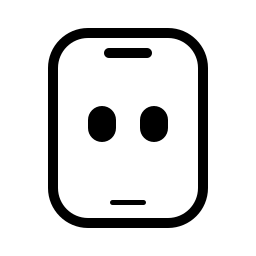

简体中文 · <a href="README.en.md">English</a>

<picture>
  <source media="(prefers-color-scheme: dark)" srcset="docs/assets/phonebot-white.svg" />
  
</picture>

<h1 align="center">PhoneBot</h1>
<h3 align="center">你的 AI，现在会用手机了。</h3>

住在你手机里的 AI 搭档。替你操作手机，处理日常事务。 
你交代，它执行。

<a href="#快速开始">快速开始</a> ·
<a href="#能做什么">能做什么</a> ·
<a href="#常见问题">常见问题</a> ·
<a href="#开发">从源码构建</a>

**无需 Root 或 Termux，运行环境内置 APK。** 连接模型、开启无障碍，即可开始操作主屏。需要虚拟屏或系统命令时，可以使用内置助手或 Shizuku。

## 演示

## 能做什么

- **用你选择的模型。** 复用 Pi 的服务商、模型目录、认证和请求能力。在 Bot 设置中选择模型，凭据加密保存在手机上。
- **接着聊，接着做。** Pi 管理会话、恢复和自动上下文压缩。关闭后再打开，可以继续已有对话。
- **替你操作手机。** 打开 App、读取页面、点击、滑动、输入中文、返回和回到主页。需要时使用中英文 OCR 或截图理解页面。
- **选择执行屏幕。** 在主屏直接操作，或让 Agent 使用独立虚拟屏。每个 Bot 保存自己的屏幕和助手选择。
- **随时看它在做什么。** 点击圆球查看虚拟屏实时画面，再点画面收起。蓝点表示任务运行中。支持浅色、深色和跟随系统。
- **处理日常设置。** 查询和调节媒体音量、设置亮度、打开系统设置入口。闹钟、计时器和日程通过系统应用办理。
- **看清执行过程。** 展开记录，查看模型返回的思考、中间文本、工具调用和结果。最终回复支持 Markdown、表格和代码块。
- **随时停止。** 缺少权限时暂停。你可以单独停止当前 Bot，任务结束后可通过通知返回对应 Bot。

可创建多个有名字和彩色头像的 Bot。不同虚拟屏可并行；主屏与同一 App 会排队。点击顶部头像配置 Bot，侧栏底部管理软件设置。

## 快速开始

当前请使用维护者提供的测试 APK，或[从源码构建](docs/build.md)。

### 1. 安装并打开

将 APK 下载到手机，在文件管理器中点击安装。按系统提示允许该文件管理器安装应用。打开 PhoneBot，内置引擎会自动启动。

### 2. 连接模型

点击右上角 **··· → 设置 → 模型服务**，选择服务商，填写 API Key 或登录账号。再点击顶部头像，在 **Bot 设置** 选择模型并 **验证连接**。在 **设置 → 外观** 切换主题。

模型需支持工具调用。使用截图理解页面时，还需支持图片输入。模型目录来自 Pi，具体认证方式由服务商决定。连接验证成功只代表该模型和当前凭据能发起请求，不代表所有手机任务都能完成。

### 3. 开启权限

打开 **设置 → 权限**，开启 **无障碍服务**。主屏操作需要手机亮屏并解锁。

按需开启 **通知权限** 和 **任务结果横幅**，接收任务结果。调节亮度需要 **修改系统设置** 权限。基础手机操作不要求 Shizuku。

### 4. 选择屏幕和助手

点击顶部头像和名字，打开 **Bot 设置**。选择当前 Bot 的模型、**主屏幕／虚拟屏幕** 和 **内置助手／Shizuku**。配置会自动保存。点击 **设为新 Bot 默认配置**，让新 Bot 继承屏幕和助手选择。

主屏普通操作不要求助手。虚拟屏需要 Android 14 及以上，以及可用的助手。设备连接和授权由所有 Bot 共享。执行中的 Bot 不能切换助手或屏幕。

任务开始后，点击 **PhoneBot 圆球** 查看虚拟屏画面，再点画面收起。圆球和画面均可拖动。主屏模式点击圆球返回会话。停止任务请使用聊天页的停止按钮。任务结束后圆球自动消失。

在 **设置 → 设备助手** 完成连接：

- **内置助手**：需要 Android 12 及以上。连接 Wi-Fi，将 PhoneBot 与系统无线调试页面分屏打开。在无线调试中打开 **使用配对码配对设备**，保持弹窗开启，在 PhoneBot 填写弹窗中的端口和六位配对码。PhoneBot 会保存配对身份，并自动查找日后连接使用的端口。Android 17 还需允许本地网络访问。
- **Shizuku**：启动 Shizuku，再授权 PhoneBot。

**配对端口与连接端口不同。** 配对页填写的是配对码弹窗中的端口。普通连接端口由 PhoneBot 查找，不要把两者混用。

配对记录不代表助手一直在线。PhoneBot 会在需要时尝试恢复连接。开启 **重启后自动恢复**，会申请恢复所需的系统授权。重启恢复仍受无线调试、Wi-Fi、系统授权和后台限制影响。需要手动处理时，请按提示连接助手，再点击 **继续任务**。

### 5. 发出第一个任务

先试一个容易核对的任务：

> 把媒体音量设为 30%。

也可以尝试：

> 打开系统显示设置。

> 打开相册，告诉我当前页面有哪些入口。

发送后，键盘会收起。展开执行记录可查看每一步；点击方形停止按钮只取消当前 Bot 的任务。任务暂停后，先处理权限或连接提示，再点击继续。

## 运行要求与当前状态

| 项目 | 说明 |
| --- | --- |
| 系统 | Android 9 及以上；截图和 OCR 需要 Android 11 及以上 |
| 架构 | ARM64 手机、x86-64 设备及模拟器 |
| 模型 | 需要可用的模型服务和网络连接；费用与额度由服务商决定 |
| 手机操作 | 主屏需要亮屏并解锁；虚拟屏需要 Android 14 及以上和可用的助手 |
| 设备助手 | 内置 ADB 助手需要 Android 12 及以上；也可使用已启动并授权的 Shizuku |
| 可选系统能力 | 直接切换 Wi-Fi 和执行系统命令使用当前会话选择的助手 |
| 验证设备 | Samsung S21（Android 14、ARM64）和 Android 16 x86-64 模拟器 |

项目处于早期测试阶段。模型、手机系统和第三方 App 页面都会影响执行效果。Pi 目录中的服务商和模型尚未逐一完成 Android 实测。虚拟屏不是应用分身，应用数据、设备音量和网络仍由整台手机共享。S21 已通过虚拟屏短时熄屏操作与联网测试。长期休眠和其他设备仍需验证。远程接管尚未提供。详细验证范围见[测试记录](docs/verification.md)。

## 数据与隐私

- 任务请求发给你配置的模型服务商。任务涉及的屏幕文字和截图可能随请求发送。
- API Key 和登录凭据通过 Android Keystore 加密保存在手机上。
- 内置助手的 ADB 身份加密保存在手机上。配对码不写入聊天或任务日志。
- 对话、执行日志和截图保存在应用私有目录。日志会保留页面信息，分享前请检查并脱敏。
- 在侧栏删除会话，会同时删除关联的执行日志、Pi 对话记录和图片存档。

## 常见问题

**需要电脑、Root 或 Termux 吗？**

基础使用不需要。安装 APK 后，在手机上连接模型并开启无障碍即可。源码构建需要电脑。

**引擎在手机上运行，是否代表模型也离线运行？**

PhoneBot 在手机上运行 Pi 引擎。模型推理由你配置的服务商处理。连接模型通常需要联网。

**如何排查运行问题？**

先在 **设置 → 运行自检** 检查内置引擎和工具通信。再到 **Bot 设置 → 验证连接** 检查真实模型请求。自检使用本地测试服务，不消耗云端模型额度，也不能代替模型连接验证。

## 开发

PhoneBot 使用 Kotlin + Jetpack Compose。独立引擎进程内嵌 Node 和 Pi 官方会话 SDK。Pi 负责模型请求、执行循环、会话恢复和自动压缩，Kotlin 提供 Android 工具。

- [构建指南](docs/build.md)：Windows 工具链、APK 生成和开发命令。
- [运行设计](docs/runtime.md)：进程、Pi 接入、工具、权限和数据存储。
- [界面设计](docs/interface.md)：聊天、执行记录、输入框和设置交互。
- [测试与验收](docs/verification.md)：测试命令、设备记录和验证边界。

反馈问题时，请提供 PhoneBot 版本、手机型号、Android 版本、服务商与模型、任务原文和失败步骤。分享日志前，请移除密钥、登录凭据和个人信息。
